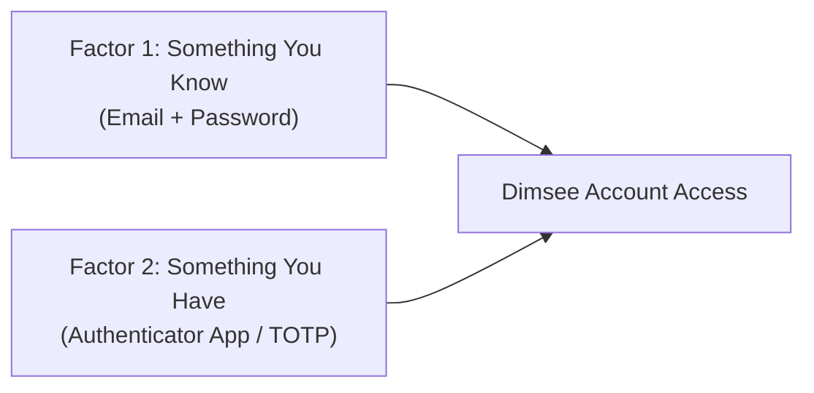
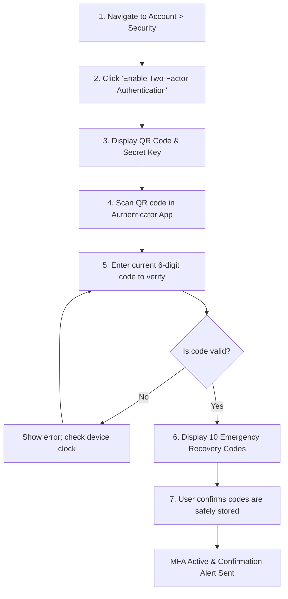
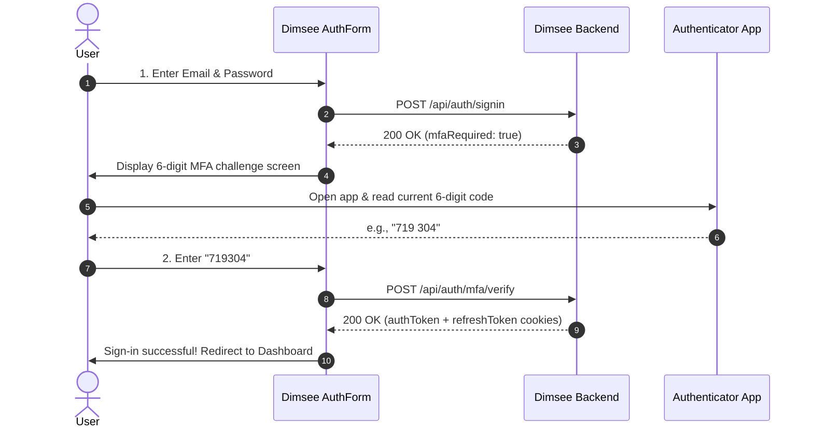
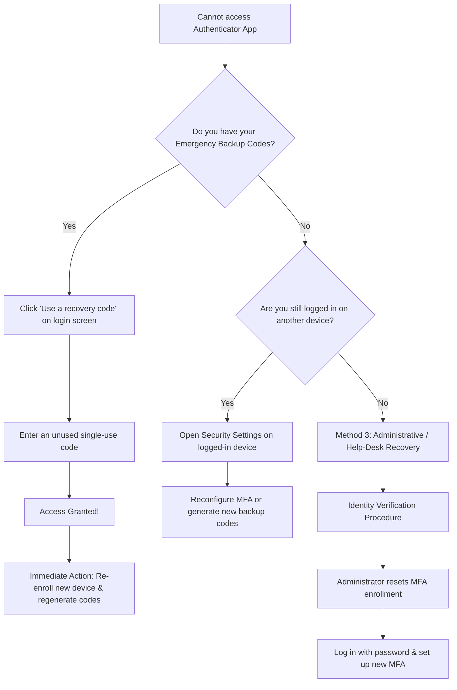

# Multi-Factor Authentication (MFA): Enrollment & Recovery Guide

This guide provides end users and developers with complete instructions for enabling Multi-Factor Authentication (MFA), completing daily sign-in challenges, managing backup codes, and recovering account access when an authenticator device is lost or inaccessible.

---

## Table of Contents

- [Overview](#overview)
  - [What is MFA?](#what-is-mfa)
  - [Supported Authenticator Apps](#supported-authenticator-apps)
  - [Key Security Concepts](#key-security-concepts)
- [Enrolling in MFA (Turning It On)](#enrolling-in-mfa-turning-it-on)
  - [Prerequisites](#prerequisites)
  - [Step-by-Step Enrollment](#step-by-step-enrollment)
  - [Safeguarding Emergency Recovery Codes](#safeguarding-emergency-recovery-codes)
- [Daily Sign-In with MFA](#daily-sign-in-with-mfa)
  - [Standard Login Flow](#standard-login-flow)
  - [OAuth Accounts with MFA](#oauth-accounts-with-mfa)
  - [Trusted Devices](#trusted-devices)
- [Recovering Account Access](#recovering-account-access)
  - [Method 1: Using an Emergency Backup Code](#method-1-using-an-emergency-backup-code)
  - [Method 2: Re-Enrolling on a New Device](#method-2-re-enrolling-on-a-new-device)
  - [Method 3: Administrative / Help-Desk Recovery](#method-3-administrative--help-desk-recovery)
- [Managing MFA Settings](#managing-mfa-settings)
  - [Viewing Remaining Backup Codes](#viewing-remaining-backup-codes)
  - [Regenerating Backup Codes](#regenerating-backup-codes)
  - [Disabling MFA](#disabling-mfa)
- [Troubleshooting & FAQs](#troubleshooting--faqs)
  - [Invalid or Expired Code](#invalid-or-expired-code)
  - [Time Synchronization Drift](#time-synchronization-drift)
  - [Lost Device and No Backup Codes](#lost-device-and-no-backup-codes)
  - [Using Multiple Devices](#using-multiple-devices)
- [Security Best Practices for Users](#security-best-practices-for-users)
- [Developer Integration Notes](#developer-integration-notes)

---

## Overview

### What is MFA?

Multi-Factor Authentication (MFA), also known as Two-Factor Authentication (2FA), adds an essential secondary barrier to your Dimsee account. Instead of relying solely on something you **know** (your password), MFA requires something you **have** (a dynamic one-time passcode generated by a trusted physical device).

Dimsee utilizes **Time-Based One-Time Passwords (TOTP)** conforming to [RFC 6238](https://datatracker.ietf.org/doc/html/rfc6238). A new 6-digit numeric verification code is computed locally on your device every 30 seconds from a shared cryptographic secret.



### Supported Authenticator Apps

You can use any standard TOTP-compliant authenticator application on your smartphone, tablet, or desktop:

| Authenticator App | Supported Platforms | Features |
| :--- | :--- | :--- |
| **Google Authenticator** | Android, iOS | Cloud sync or local-only storage |
| **Microsoft Authenticator** | Android, iOS | Encrypted cloud backup |
| **1Password / Bitwarden** | Android, iOS, Windows, macOS, Linux, Browser | Automatic autofill, multi-device sync |
| **Apple Passwords / Keychain** | iOS, iPadOS, macOS | Native autofill across Apple devices |
| **2FAS Authenticator** | Android, iOS | Open-source, offline encrypted backups |
| **Authy** | Android, iOS | Multi-device sync |

> [!NOTE]
> Hardware security keys (FIDO2/WebAuthn) and SMS verification are tracked on the Dimsee roadmap. TOTP authenticator apps are currently the primary, highly secure default.

### Key Security Concepts

1. **Shared Secret Key:** A unique base32-encoded cryptographic seed generated during enrollment. It is stored securely on the server and within your authenticator app.
2. **Time Step:** 30-second intervals during which a specific 6-digit code remains valid.
3. **Emergency Recovery Codes:** Single-use alphanumeric codes generated when you enroll. They bypass the TOTP requirement if your authenticator device is lost, damaged, or wiped.

---

## Enrolling in MFA (Turning It On)

Enrolling takes less than two minutes. Once enabled, no one can log in with just your password.

### Prerequisites

- A verified Dimsee user account (local email/password or linked OAuth provider).
- A mobile phone or desktop with a supported authenticator app installed.

### Step-by-Step Enrollment



#### Step 1: Open Account Security Settings

1. Log in to your application.
2. Click your profile avatar or username in the navigation bar.
3. Select **Account Settings** (or **Security Settings**).
4. Locate the **Two-Factor Authentication (MFA)** section.

#### Step 2: Initiate Setup

1. Click **Set up Two-Factor Authentication** (or **Enable MFA**).
2. For your security, you may be prompted to re-enter your current password to confirm your identity.

#### Step 3: Scan the QR Code

A setup modal will appear displaying a unique QR code alongside a manual entry secret key:

```
+---------------------------------------------------------+
|                  Enable Authenticator App               |
|                                                         |
|   1. Open your authenticator app (Google Authenticator, |
|      1Password, Bitwarden, etc.).                       |
|   2. Scan this QR code with your camera:                |
|                                                         |
|                  [  QR CODE IMAGE  ]                    |
|                                                         |
|   Cannot scan? Enter this secret key manually:          |
|   JBSWY3DPEHPK3PXPJBSWY3DPEHPK3PXP                      |
|                                                         |
|   Account: user@example.com (Dimsee)                    |
|   Type: Time-based (TOTP)                               |
+---------------------------------------------------------+
```

- **Using your camera:** Open your authenticator app, tap **Add Account** (`+`), and select **Scan QR Code**. Align your camera with the screen.
- **Manual setup (Desktop / No camera):** Select **Enter setup key** in your authenticator app. Set the account name to `Dimsee (user@example.com)`, paste the 32-character key, and ensure **Time-based** is selected.

#### Step 4: Verify Your First Code

1. Your authenticator app will begin generating a rotating 6-digit code every 30 seconds.
2. In the Dimsee setup prompt, enter the current 6-digit code shown in your app (e.g., `482 910`).
3. Click **Verify and Continue**.

> [!IMPORTANT]
> The verification step confirms that your device and the server are synchronized before MFA is locked to your account. If the code fails, make sure your phone's clock is set to automatic time.

#### Step 5: Save Your Emergency Recovery Codes

Upon successful verification of your first code, Dimsee will generate and display a set of **10 single-use emergency recovery codes**.

```
+---------------------------------------------------------+
|               Save Your Emergency Recovery Codes        |
|                                                         |
|  If you lose access to your authenticator device, these |
|  recovery codes are the ONLY way to regain access.      |
|  Each code can only be used ONCE.                       |
|                                                         |
|    1. A3F8-9K2M         6. 8L1P-4X9Q                    |
|    2. 7B2C-1E4N         7. 3M5N-7T2W                    |
|    3. 5H9D-8R6V         8. 9Q4R-2V8Y                    |
|    4. 2K4M-3T8Z         9. 6W2Z-5A1D                    |
|    5. 6P7X-5W3L        10. 1C8E-9F4H                    |
|                                                         |
|  [ Copy to Clipboard ]   [ Download .txt ]   [ Print ]  |
|                                                         |
|  [x] I have safely stored these emergency recovery codes|
|                                                         |
|                    [ Complete Setup ]                   |
+---------------------------------------------------------+
```

1. Click **Copy to Clipboard**, **Download .txt**, or **Print**.
2. Save these codes in a secure location (see [Safeguarding Emergency Recovery Codes](#safeguarding-emergency-recovery-codes)).
3. Check the box **"I have safely stored these emergency recovery codes"**.
4. Click **Complete Setup**.

#### Step 6: Confirmation

Your account status will immediately update to **MFA Enabled**. You will also receive an email notification alerting you that two-factor authentication was activated.

---

### Safeguarding Emergency Recovery Codes

Emergency recovery codes are your safety net. If your phone is stolen, dropped in water, or wiped, these codes guarantee you can log back in.

> [!WARNING]
> Treat recovery codes with the same sensitivity as your master password. Anyone who has your password and a recovery code can access your account.

**Recommended Storage Methods:**
- **Password Manager (Best):** Store them in the encrypted notes section of your password manager (e.g., 1Password, Bitwarden, KeePass).
- **Encrypted USB / Drive:** Save the text file on a BitLocker or FileVault encrypted backup drive.
- **Physical Safe:** Print the codes and store the physical paper in a fireproof safe or locked drawer.

**DO NOT:**
- Save recovery codes in plain text desktop files or unencrypted cloud notes.
- Email them to yourself or send them in messaging apps.
- Take a screenshot and keep it in your unencrypted camera roll.

---

## Daily Sign-In with MFA

### Standard Login Flow

Once MFA is enabled, logging in becomes a two-step process:



1. **Step 1:** On the sign-in screen, enter your email/username and password as usual. Click **Sign In**.
2. **Step 2:** Dimsee validates your credentials and presents the **Two-Factor Authentication Challenge**:
   - Open your authenticator app.
   - Find the entry labeled with your account name and `Dimsee`.
   - Type the current 6-digit code into the prompt.
3. Click **Verify**. You are immediately logged in to your account.

### OAuth Accounts with MFA

If you sign in using Google or GitHub OAuth, Dimsee provides continuous protection:
1. Click **Sign in with Google** or **Sign in with GitHub**.
2. Complete authentication on Google or GitHub's authorization screen.
3. When redirected back to Dimsee, if MFA is enabled on your account, the 6-digit TOTP challenge is presented before session cookies are granted.

### Trusted Devices

Depending on your organization's configuration, you may see a checkbox labeled **"Trust this browser for 30 days"**.
- When checked, Dimsee stores an encrypted, cryptographically signed device token in your browser.
- Future sign-ins on that specific device and browser will only require your password for the next 30 days.
- If you log in from an incognito window, a new browser, or a different computer, the 6-digit MFA challenge will always be required.

> [!CAUTION]
> Never check "Trust this device" on public or shared computers (e.g., libraries, internet cafes, shared lab workstations).

---

## Recovering Account Access

When you do not have access to your authenticator app, do not panic. Follow the recovery pathways outlined below.



---

### Method 1: Using an Emergency Backup Code

This is the primary self-service recovery mechanism.

1. Navigate to the login page and enter your email/username and password.
2. When the 6-digit MFA challenge screen appears, click **"Use a recovery code"** (or **"Lost access to your authenticator?"**).

```
+---------------------------------------------------------+
|                  Two-Factor Authentication              |
|                                                         |
|   Enter the 6-digit code from your authenticator app.   |
|                                                         |
|   [  _  _  _    _  _  _  ]                              |
|                                                         |
|   [ Verify ]                                            |
|                                                         |
|   --> Can't access your phone? Use a recovery code <--  |
+---------------------------------------------------------+
```

3. The input field will switch to accept your alphanumeric emergency code.
4. Paste or type one of your unused recovery codes (e.g., `A3F8-9K2M`).

```
+---------------------------------------------------------+
|                  Emergency Account Recovery             |
|                                                         |
|   Enter one of your 8-to-10 character recovery codes.   |
|   Each code can only be used once.                      |
|                                                         |
|   [ A3F8-9K2M                                   ]       |
|                                                         |
|   [ Verify Recovery Code ]                              |
|                                                         |
|   Back to standard 6-digit code                         |
+---------------------------------------------------------+
```

5. Click **Verify Recovery Code**.
6. **Access Granted:** Dimsee will log you in and mark that specific recovery code as **consumed/burned**. It can never be used again.
7. An email alert will notify you: *"An emergency recovery code was used to access your Dimsee account."*

> [!IMPORTANT]
> As soon as you log in using a recovery code, navigate directly to **Account Settings > Security** to set up MFA on your new phone and regenerate your remaining backup codes.

---

### Method 2: Re-Enrolling on a New Device

If you bought a new phone or wiped your device, but still have your recovery codes or an existing active session:

1. Log in using a recovery code (or open your existing active session).
2. Go to **Account Settings > Security**.
3. Under **Two-Factor Authentication**, click **Reconfigure Authenticator** (or **Replace Device**).
4. Enter your current password for step-up verification.
5. A new QR code and secret key will be generated.
6. Open your authenticator app on your new device and scan the new QR code.
7. Enter the 6-digit code from the new device to confirm the pairing.
8. Click **Generate New Recovery Codes** to refresh your recovery list.

> [!NOTE]
> Re-enrolling immediately revokes the old secret key. The authenticator app on your old phone will no longer generate valid codes for your account.

---

### Method 3: Administrative / Help-Desk Recovery

If you have lost your authenticator device **and** have lost all emergency recovery codes, self-service recovery is impossible. You must contact your application administrator or support team.

#### Why is this strictly controlled?
MFA is designed to prevent account takeovers. If support agents could disable MFA without rigorous identity verification, attackers could impersonate you and bypass your security.

#### Step-by-Step Help-Desk Flow:

1. **Submit a Recovery Request:** Contact support via the official support portal or help email.
2. **Identity Proofing (Out-of-Band Verification):**
   - You will be asked to confirm account details that cannot be spoofed easily.
   - Depending on organizational policies, this may include verifying your registered email address via an out-of-band link, confirming billing/transaction details, or video/photo ID verification.
3. **Cooling-Off Period (Optional for High-Security Tiers):** Some deployments enforce a 24-hour notification delay sent to the registered email and phone number to alert the real owner of a potential takeover attempt.
4. **Admin Reset Action:**
   - The administrator navigates to the User Management console and clicks **Reset MFA for User**.
   - Dimsee invalidates the user's MFA secret, burns all remaining recovery codes, and **revokes all active sessions and refresh tokens across all devices**.
5. **Re-Enrollment on Next Login:**
   - You log in using your primary password.
   - Dimsee prompts you to immediately enroll a new authenticator app and save fresh recovery codes before accessing application data.

---

## Managing MFA Settings

### Viewing Remaining Backup Codes

To check how many emergency codes you have left:
1. Go to **Account Settings > Security**.
2. Under **Two-Factor Authentication**, view the status:
   - *Example:* `"MFA is Enabled (7 of 10 recovery codes remaining)"`.

> [!TIP]
> If you have fewer than 3 recovery codes left, regenerate a new batch immediately so you never risk running out.

### Regenerating Backup Codes

If you have used several backup codes or suspect your codes were exposed:

1. Go to **Account Settings > Security**.
2. Click **Regenerate Recovery Codes**.
3. Re-enter your password and current 6-digit authenticator code.
4. A brand new set of 10 codes will be displayed.
5. Save the new codes in your password manager.

> [!WARNING]
> Generating a new set of recovery codes **immediately invalidates all previous backup codes**. Destroy any previously printed sheets or deleted old notes.

### Disabling MFA

If you must disable MFA (for example, before transferring an account or testing):

1. Go to **Account Settings > Security**.
2. Click **Turn Off Two-Factor Authentication**.
3. Enter your current password and your current 6-digit authenticator code (or an emergency backup code).
4. Click **Confirm Deactivation**.
5. Your account reverts to password-only authentication.

> [!CAUTION]
> Disabling MFA significantly lowers your account's defense against password theft, credential stuffing, and data breaches. We strongly recommend keeping MFA enabled at all times.

---

## Troubleshooting & FAQs

### Invalid or Expired Code

**Symptom:** You enter the 6-digit code displayed in your app, but Dimsee shows `"Invalid verification code. Please try again."`

**Causes and Solutions:**
1. **The code expired:** TOTP codes are valid for 30 seconds. If you entered the code right as the timer in your app turned red or changed, wait for the next code to generate and enter it promptly.
2. **Typo:** Verify you entered all 6 digits without letters or punctuation.
3. **Wrong account:** If you have multiple accounts configured in your authenticator app, double-check that you are reading the code under the correct email and `Dimsee` label.

---

### Time Synchronization Drift

**Symptom:** Codes are consistently rejected even when entered immediately.

**Cause:** TOTP relies on cryptographic timestamps. If your phone's clock differs from standard UTC by more than 30–60 seconds, your phone generates codes for a different time window than the server.

**How to Fix:**

- **On Android (Google Authenticator):**
  1. Open Google Authenticator.
  2. Tap the **Menu** (three dots) > **Settings**.
  3. Tap **Time correction for codes** > **Sync now**.
  4. The app will confirm whether the time was synchronized.

- **On Android (System Settings):**
  1. Open Android **Settings** > **System** > **Date & time**.
  2. Toggle **Set time automatically** and **Set time zone automatically** to **ON**.

- **On iOS (iPhone / iPad):**
  1. Open **Settings** > **General** > **Date & Time**.
  2. Toggle **Set Automatically** to **ON**. If already on, toggle it OFF for 5 seconds and back ON.

---

### Lost Device and No Backup Codes

**Symptom:** You lost your phone and do not have your recovery codes saved.

**Solution:** Follow [Method 3: Administrative / Help-Desk Recovery](#method-3-administrative--help-desk-recovery). Contact your system administrator to initiate verified identity recovery.

---

### Using Multiple Devices

**Question:** *Can I have my MFA codes on both my phone and my iPad/laptop?*

**Answer:** Yes! When setting up MFA:
- Scan the same QR code on your phone and your tablet or secondary device before clicking **Verify**.
- Alternatively, if you use a password manager with built-in authenticator support (1Password, Bitwarden), your 6-digit codes will automatically synchronize encrypted across all your authorized devices.

---

## Security Best Practices for Users

1. **Never Share Your Codes:** No member of the Dimsee team or application support will ever ask for your 6-digit code or emergency recovery codes. If someone asks, it is a phishing attempt.
2. **Beware of Prompt Fatigue:** If you receive an MFA prompt or notification on your phone when you are not trying to log in, click **Deny**, change your password immediately, and review active sessions.
3. **Keep Authenticator Backups Enabled:** If using Google Authenticator or Microsoft Authenticator, enable encrypted cloud sync so that purchasing a new phone does not lock you out of your accounts.
4. **Regularly Audit Active Sessions:** Go to your account profile periodically to review logged-in sessions and terminate unfamiliar browsers.

---

## Developer Integration Notes

For developers implementing Dimsee in a MERN application, the following architecture powers the user-facing MFA workflows:

### REST API Endpoints

| Method | Endpoint | Description | Auth Required |
| :--- | :--- | :--- | :--- |
| `POST` | `/api/auth/mfa/setup` | Generates a new TOTP secret & QR code URI | Session / JWT |
| `POST` | `/api/auth/mfa/enable` | Verifies initial TOTP code & issues 10 hashed backup codes | Session / JWT |
| `POST` | `/api/auth/mfa/verify` | Validates 6-digit TOTP or backup code during login challenge | Pre-auth Token |
| `POST` | `/api/auth/mfa/recovery-codes/regenerate` | Generates fresh recovery codes (burns previous set) | Session + Step-up |
| `POST` | `/api/auth/mfa/disable` | Deactivates MFA on account | Session + Step-up |

### Database Schema Requirements (MongoDB / Mongoose)

```javascript
// backend/models/User.js MFA extension schema
mfa: {
  enabled: {
    type: Boolean,
    default: false
  },
  secret: {
    type: String // Encrypted or base32-encoded TOTP seed
  },
  recoveryCodes: [{
    codeHash: {
      type: String, // Bcrypt or Argon2 hash of recovery code (NEVER stored plaintext)
      required: true
    },
    used: {
      type: Boolean,
      default: false
    },
    usedAt: {
      type: Date
    }
  }],
  enrolledAt: {
    type: Date
  }
}
```

### Security Invariants for Implementation

- **Never Store Plaintext Recovery Codes:** Like passwords, backup codes must be hashed (e.g. with `bcrypt`) before saving to MongoDB. Return plaintext codes to the user only once upon generation.
- **Single-Use Enforcement:** Upon code consumption, set `used: true` and record `usedAt` in MongoDB within an atomic transaction or atomic update.
- **Rate Limiting:** Protect `/api/auth/mfa/verify` with strict rate limiting (e.g., maximum 5 failed attempts per 5 minutes) to prevent brute-forcing 6-digit TOTP combinations or recovery codes.
- **Session Revocation on MFA Reset:** When an administrator resets a user's MFA, ensure all refresh tokens are rotated/cleared (`user.refreshToken = null`) to revoke existing attacker sessions.
