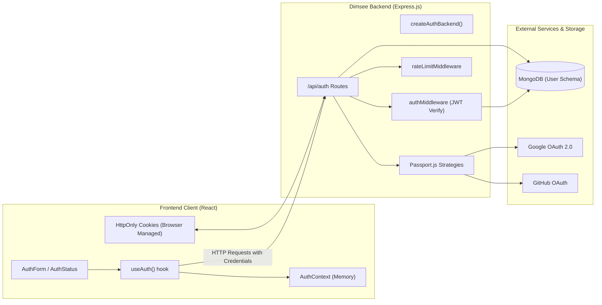
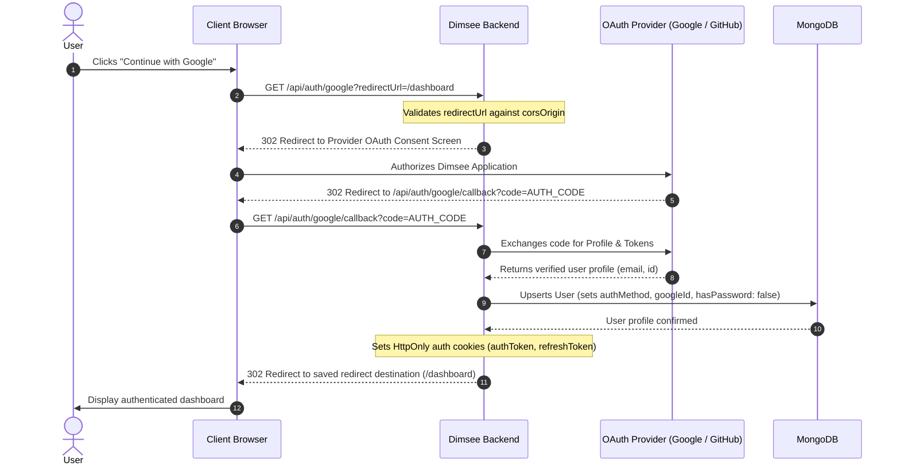
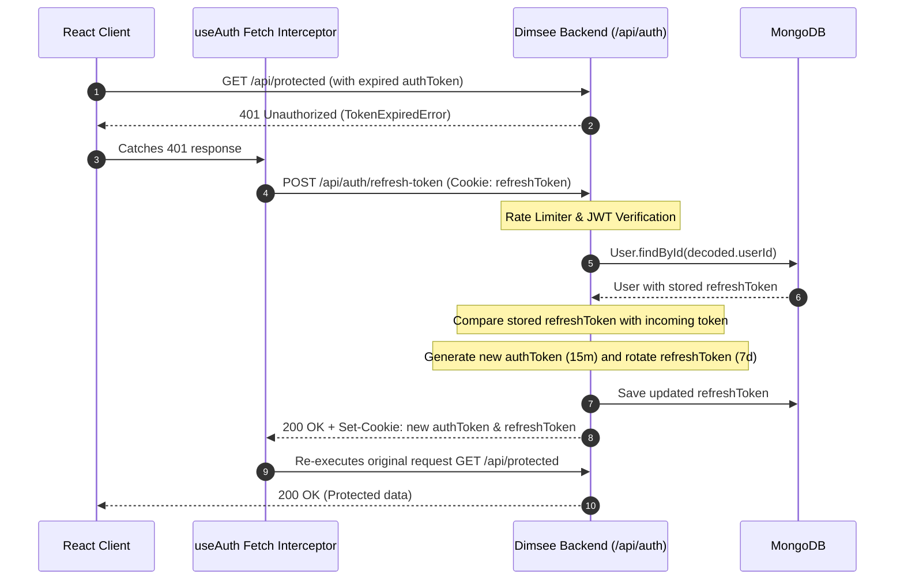
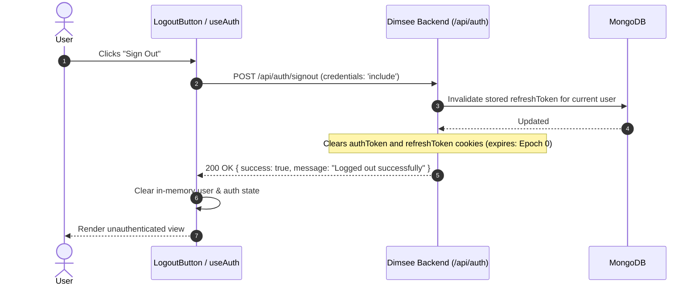

# Dimsee Architecture & Authentication Flows

This document details the architectural layout and core authentication workflows implemented in Dimsee.

---

## 1. High-Level System Architecture



---

## 2. Local Signup & Signin Flow

```mermaid
sequenceDiagram
    autonumber
    actor User as User / Browser
    participant React as AuthForm / useAuth
    participant API as Dimsee Backend (/api/auth)
    participant DB as MongoDB

    User->>React: Enters username, email, password
    React->>API: POST /api/auth/signup (JSON)
    Note over API: Zod Validation (Username, Email, Password complexity)
    API->>DB: User.findOne({ $or: [email, username] })
    DB-->>API: Not found
    API->>DB: User.create({ password: bcryptHash(...) })
    DB-->>API: User created
    API-->>React: 201 Created (User info)

    User->>React: Enters credentials to Sign In
    React->>API: POST /api/auth/signin (JSON)
    Note over API: Rate limiter check & Passport Local authentication
    API->>DB: User.findOne({ email })
    DB-->>API: User record (with bcrypt hash)
    Note over API: bcrypt.compare(password, hash)
    API->>DB: user.refreshToken = newJwtRefreshToken; await user.save()
    Note over API: Generate authToken (15m) & refreshToken (7d)
    API-->>React: 200 OK + Set-Cookie: authToken & refreshToken (HttpOnly, Secure)
    React-->>User: Authenticated state rendered
```

---

## 3. OAuth Authentication Flow (Google / GitHub)



---

## 4. Refresh Token Rotation Flow



---

## 5. Session Termination (Signout) Flow


